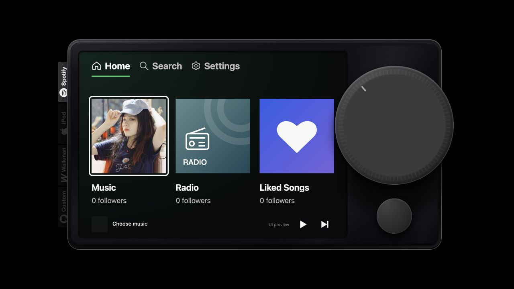
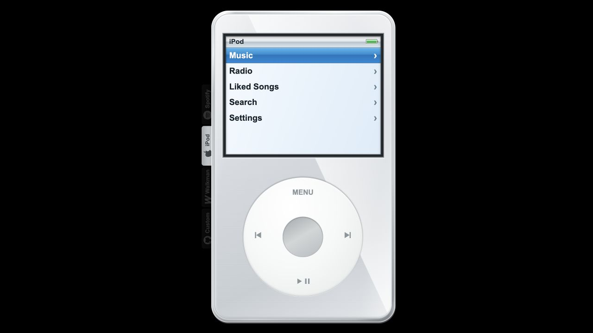
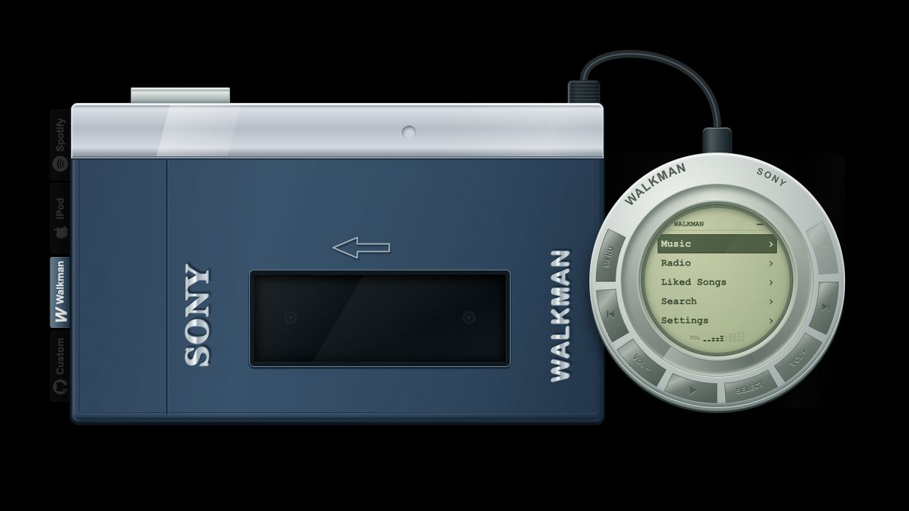
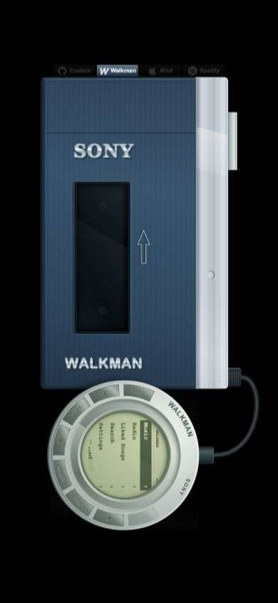

<p align="right"><strong>English</strong> | <a href="README.zh-CN.md">中文</a></p>

<p align="center">
  
</p>

<h1 align="center">Music Player</h1>

<p align="center">Bring the tactile feel of Car Thing, iPod, and Walkman to the desktop and the browser.</p>

<p align="center">
  <a href="https://magic-bunny.github.io/music-player/">Try it online</a> ·
  <a href="https://github.com/magic-bunny/music-player/releases/tag/v1.0.0">Download desktop 1.0</a> ·
  <a href="https://github.com/magic-bunny/music-player/releases/tag/android-v1.0.0-preview.1">Android preview</a> ·
  <a href="docs/CUSTOM_SKINS.md">Build a custom skin</a>
</p>

Music Player is a skeuomorphic music player. Three hardware appearances share the same playback, playlist, radio, favorites, search, volume, and persistence logic. The desktop app can play local music, while the static browser edition can be hosted on GitHub Pages.

## Three classic appearances

| Car Thing | iPod | Walkman TPS-L2 |
| --- | --- | --- |
|  |  |  |
| Piano-black hardware, a large rotary dial, and a player palette derived from the artwork | A square color display, Cover Flow, and Click Wheel controls | Blue and silver metal, a cassette window, and a circular LCD remote |

The labels on the left switch appearances without rebuilding player state. A fourth GitHub label opens the customization guide. The active appearance is fully visible while the other labels remain at 20% opacity along the hardware edge.

## Features

- **One player, three pieces of hardware.** Rotary input, mouse wheel input, touch rotation, the Click Wheel, and the Walkman remote all enter the same control functions.
- **Real playlists and radio.** The desktop app supports NetEase Music and Audius. The Web edition uses Audius, Radio Browser, and manual FM tuning simulation.
- **Local music.** The desktop app imports a folder as a playlist and recognizes matching playlist artwork, track artwork, and LRC lyrics.
- **Shared playback state.** Favorites, queue, volume, progress, the current track, and the mini player remain consistent across appearances.
- **Shared desktop and Web code.** Tauri provides native windows, files, and audio; the browser edition uses the same interface and application modules.
- **Responsive hardware stage.** Desktop browsers center the player in both directions. Phones maximize it within safe areas and avoid iPhone cutouts, Dynamic Island, Android cameras, and gesture regions. iPod stays portrait; Car Thing and Walkman use landscape hardware layouts.
- **Local persistence.** Language, music source, appearance, favorites, and radio stations use localStorage. Imported browser media is stored in IndexedDB.

## Desktop downloads

| Platform | Package |
| --- | --- |
| macOS Apple Silicon | [DMG](https://github.com/magic-bunny/music-player/releases/download/v1.0.0/music-player-1.0.0-darwin-aarch64.dmg) |
| macOS Intel | [DMG](https://github.com/magic-bunny/music-player/releases/download/v1.0.0/music-player-1.0.0-darwin-x64.dmg) |
| Windows x64 | [NSIS EXE](https://github.com/magic-bunny/music-player/releases/download/v1.0.0/music-player-1.0.0-windows-x64-setup.exe) · [MSI](https://github.com/magic-bunny/music-player/releases/download/v1.0.0/music-player-1.0.0-windows-x64.msi) |
| Linux x64 | [AppImage](https://github.com/magic-bunny/music-player/releases/download/v1.0.0/music-player-1.0.0-linux-amd64.AppImage) · [deb](https://github.com/magic-bunny/music-player/releases/download/v1.0.0/music-player-1.0.0-linux-amd64.deb) |

GitHub Actions builds the 1.0 packages on macOS, Windows, and Linux and attaches them to one release. The first `v1.0.0` macOS packages use ad-hoc signing, so Gatekeeper warns that it cannot verify the developer. Future macOS releases must be signed with Apple Developer ID and notarized. Windows packages are not yet Authenticode-signed.

If the current `v1.0.0` DMG shows “Apple cannot verify Music Player,” attempt to open it once, then open **System Settings → Privacy & Security**, find Music Player in the Security section, and choose **Open Anyway**. Only do this for packages downloaded from this project's GitHub Release.

If **Open Anyway** is unavailable, drag **Music Player.app** into the Applications folder, open Terminal, and remove the quarantine attribute from this app only:

```sh
sudo xattr -rd com.apple.quarantine "/Applications/Music Player.app"
open -a "Music Player"
```

Enter the macOS administrator password when prompted; Terminal does not display password characters while typing. You only need to run this command once for the installed copy. Reinstalling, replacing, or upgrading to another unnotarized copy may require running it again. This command bypasses Gatekeeper for this copy of Music Player, so use it only after downloading the DMG from this project's GitHub Release. A future Developer ID-signed and notarized release will not require this step.

Maintainers must configure Apple Developer ID and notarization credentials before publishing another release. See [macOS release signing](docs/MACOS_RELEASE.md). The workflow stops macOS packaging when credentials are absent, preventing another unverified DMG from being uploaded.

## Android preview

Download the [Android 1.0 preview APK](https://github.com/magic-bunny/music-player/releases/download/android-v1.0.0-preview.1/music-player-1.0.0-android-arm64.apk). It supports ARM64 devices running Android 8.0 or newer. Allow APK installation for the browser or file manager you use, download the package, and open it to install.

This first APK is a sideload preview rather than a Play Store production build. It uses a CI-generated preview certificate, so a later preview may require uninstalling the previous APK before installation. Local-folder playlist import is not available in the first Android preview; network music, radio, favorites, settings, playback, rotary touch controls, and all three skins use the shared application code.

## User guide

### Choose content

Home presents Music, Radio, and Liked Songs. Music opens a playlist collection before showing its tracks. Radio includes ten default stations, a More collection, and manual tuning. Cover collections support horizontal touch or mouse scrolling; track lists scroll vertically.

The large dial accepts mouse-wheel input while hovered, pointer dragging around its edge, and touch rotation. Rotate to select and press the center to confirm. On music and FM player screens, rotation controls volume instead.

### Hardware controls

- **Car Thing:** Rotate the large dial to select or adjust volume, press its center to confirm, and use the small round button to go back. The player screen includes previous, play/pause, next, and favorite controls.
- **iPod:** Rotate the Click Wheel to select, press the center to confirm, use MENU to go back, use the left and right buttons to change tracks, and use the bottom button for play/pause. Playlists and stations use Cover Flow.
- **Walkman:** Rotate the outer remote control to select. Its recessed physical keys provide MENU, track navigation, volume, play/pause, favorite, and SELECT. The silver key on top of the player also controls play/pause.

### Mini player

Press Back on Home to scale the player into the lower-right mini bar. Click its artwork to restore the full player and open the current playback screen. The close icon exits the desktop app. When a browser cannot close a user-created tab, Music Player hides the interface and leaves a control that can reopen it.

### Settings and data

Settings switches between Chinese, English, Japanese, and the sources available on the current platform. The desktop app defaults to NetEase Music and also offers Audius; the Web edition currently uses Audius. Configuration and favorites are stored in the current app or site storage and do not synchronize automatically. Clearing browser site data removes Web favorites and imported files.

## Web edition

Online app: [magic-bunny.github.io/music-player](https://magic-bunny.github.io/music-player/)

The Web background is pure black so every irregular hardware outline remains visible. Desktop browsers center the active hardware horizontally and vertically. Phones read `safe-area-inset-*` and enlarge the player within the safe area. iPod remains upright, while Car Thing and Walkman rotate as complete units on portrait phones and use their native landscape layout on landscape phones.

<p align="center"></p>

Run the static edition locally:

```sh
node scripts/build-pages.mjs
python3 -m http.server 8765 --bind 127.0.0.1 --directory dist
```

Open `http://127.0.0.1:8765/`. The generated `dist/` directory does not require Rust, Node, or a backend service at runtime, and its asset paths work under a GitHub Pages project subdirectory.

## Development

The desktop edition requires stable Rust and the Tauri system dependencies for the current platform:

```sh
source "$HOME/.cargo/env"
cargo run --release --locked
```

Verification:

```sh
node --test scripts/*.test.mjs
node scripts/build-pages.mjs
cargo fmt --check
cargo test --locked
cargo clippy --all-targets -- -D warnings
```

Build an ARM64 Android APK with Android SDK 36, NDK 28.2, Java 17, and the `aarch64-linux-android` Rust target installed:

```sh
npm ci
npm run android:build
```

Repository layout:

```text
web/core/          Playback, navigation, state, storage, and provider contracts
web/platform/      Browser and Tauri adapters
web/ui/skins/      Appearance descriptors and presenters
src-tauri/         Native audio, windows, local files, and providers
scripts/           Build, unit, and browser-layout checks
docs/              Customization guides and README images
.github/workflows/ CI, Pages, and desktop releases
```

See [ARCHITECTURE.md](ARCHITECTURE.md) for system boundaries and [DESIGN.md](DESIGN.md) for visual constraints. The developer extension workflow is documented in [Custom skins](docs/CUSTOM_SKINS.md).

## Music sources and trademarks

Audius uses its official public API, and radio stations come from Radio Browser. The desktop edition defaults to NetEase Music and also supports Audius. The Web edition currently uses Audius because a static GitHub Pages site cannot provide the server-side NetEase compatibility layer required for reliable browser access. Spotify, iPod, Walkman, Apple, and Sony names and appearances identify design inspiration only. This project is not affiliated with those brands.
