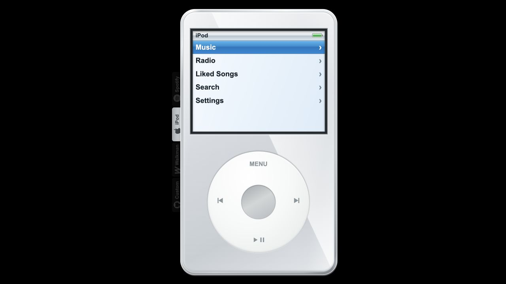
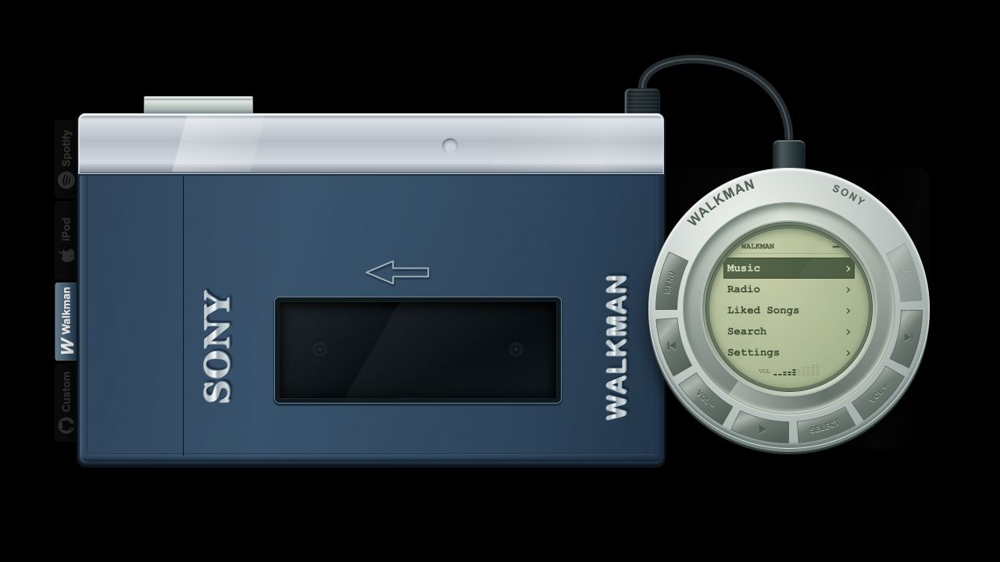
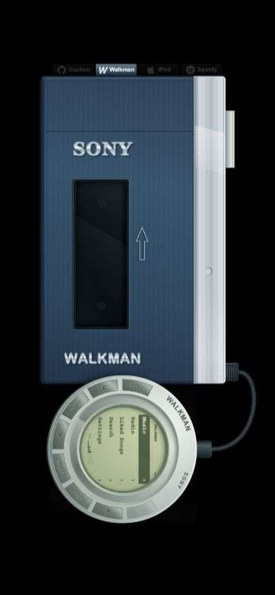

<p align="right"><a href="README.md">English</a> | <strong>中文</strong></p>

<p align="center">
  
</p>

<h1 align="center">Music Player</h1>

<p align="center">把 Car Thing、iPod 和 Walkman 的触感带回桌面与浏览器。</p>

<p align="center">
  <a href="https://magic-bunny.github.io/music-player/">在线体验</a> ·
  <a href="https://github.com/magic-bunny/music-player/releases/tag/v1.0.0">下载桌面版 1.0</a> ·
  <a href="docs/CUSTOM_SKINS.md">自定义皮肤</a>
</p>

Music Player 是一个拟物音乐播放器。三套硬件外观共享同一套播放、歌单、电台、收藏、搜索、音量和持久化逻辑；你可以在桌面应用中使用本地音乐，也可以把纯静态 Web 版本部署到 GitHub Pages。

## 三套经典外观

| Car Thing | iPod | Walkman TPS-L2 |
| --- | --- | --- |
|  |  |  |
| 黑色钢琴烤漆机身、大旋钮与随封面取色的播放屏幕 | 直角彩屏、Cover Flow 与 Click Wheel 操作 | 蓝银金属机身、卡带窗与圆形液晶线控 |

左侧标签可以随时切换外观，播放器状态不会重建。第四个 GitHub 标签打开开发者自定义说明；选中的皮肤完全可见，其他标签以 20% 透明度保留在硬件边缘。

## 产品特点

- **一套播放器，三种硬件。** 旋钮、滚轮、触摸旋转、Click Wheel 和线控最终进入同一套控制函数。
- **真实歌单与电台。** 桌面版支持网易云与 Audius；Web 版使用 Audius、Radio Browser 与手动 FM 调频模拟。
- **本地音乐。** 桌面版可把文件夹作为歌单导入，并识别同名歌单封面、歌曲封面与 LRC 歌词。
- **播放状态始终一致。** 红心、队列、音量、进度、当前歌曲和迷你播放条在皮肤之间共享。
- **桌面与 Web 共用代码。** Tauri 只承载原生窗口、文件和音频能力；Browser 版使用同一套界面与业务模块。
- **响应式硬件舞台。** 桌面端横向和纵向居中；手机端尽量填满安全区域，避开 iPhone 刘海、Dynamic Island、Android 摄像头与手势条。iPod 保持竖向，Car Thing 与 Walkman 使用横向硬件布局。
- **本地持久化。** 语言、来源、皮肤、收藏与电台使用 localStorage；Web 导入的二进制媒体使用 IndexedDB。

## 下载桌面版

| 平台 | 安装包 |
| --- | --- |
| macOS Apple Silicon | [DMG](https://github.com/magic-bunny/music-player/releases/download/v1.0.0/music-player-1.0.0-darwin-aarch64.dmg) |
| macOS Intel | [DMG](https://github.com/magic-bunny/music-player/releases/download/v1.0.0/music-player-1.0.0-darwin-x64.dmg) |
| Windows x64 | [NSIS EXE](https://github.com/magic-bunny/music-player/releases/download/v1.0.0/music-player-1.0.0-windows-x64-setup.exe) · [MSI](https://github.com/magic-bunny/music-player/releases/download/v1.0.0/music-player-1.0.0-windows-x64.msi) |
| Linux x64 | [AppImage](https://github.com/magic-bunny/music-player/releases/download/v1.0.0/music-player-1.0.0-linux-amd64.AppImage) · [deb](https://github.com/magic-bunny/music-player/releases/download/v1.0.0/music-player-1.0.0-linux-amd64.deb) |

1.0 安装包由 GitHub Actions 在 macOS、Windows 和 Linux runner 上分别构建并附加到同一个 Release。首批 `v1.0.0` macOS 安装包使用临时签名，Gatekeeper 会提示无法验证开发者；后续 macOS Release 必须通过 Apple Developer ID 签名和公证后才能发布。Windows 安装包目前尚未进行 Authenticode 签名。

如果当前 `v1.0.0` DMG 出现“Apple 无法验证 Music Player”的提示，首次启动失败后打开“系统设置 → 隐私与安全性”，在安全性区域找到 Music Player 并选择“仍要打开”。这个操作只应对从本项目 GitHub Release 下载的安装包执行。

如果系统设置中没有“仍要打开”，先把 **Music Player.app** 拖入“应用程序”文件夹，再打开“终端”，只移除这个应用的 quarantine 属性：

```sh
sudo xattr -rd com.apple.quarantine "/Applications/Music Player.app"
open -a "Music Player"
```

系统提示时输入 macOS 管理员密码；终端输入密码期间不会显示字符。同一份已安装的应用只需在首次安装后执行一次；如果重新安装、覆盖应用或升级到另一份未公证的版本，可能需要再次执行。这个命令会让当前这份 Music Player 绕过 Gatekeeper，因此只应对从本项目 GitHub Release 下载的 DMG 使用。后续使用 Developer ID 签名并通过 Apple 公证的版本将不再需要这一步。

维护者发布新版前需要配置 Apple Developer ID 与公证凭据，具体步骤见 [macOS 发布说明](docs/MACOS_RELEASE.md)。CI 在凭据缺失时会停止 macOS 打包，避免继续上传无法通过 Gatekeeper 的 DMG。

## 使用手册

### 选择内容

Home 展示 Music、Radio 和 Liked Songs。进入 Music 后先选择歌单，再进入歌曲列表；Radio 提供默认电台、More 列表和手动调频。封面列表可以触摸或鼠标横向滑动，歌曲列表可以纵向滚动。

大旋钮支持三种输入：鼠标悬停时滚轮、按住旋钮边缘拖动，以及触摸屏上的旋转手势。旋转负责选择，按下中心负责确认。播放页和 FM 播放页中，旋转改为控制音量。

### 三套硬件操作

- **Car Thing：** 大旋钮选择或调音量，中心按下确认；小圆键返回。播放页提供上一曲、播放/暂停、下一曲和红心。
- **iPod：** Click Wheel 转动选择，中心键确认，MENU 返回；左右键切曲，底部键播放/暂停。歌单和电台使用 Cover Flow。
- **Walkman：** 圆形线控外圈选择；实体弧形按键提供 MENU、切曲、音量、播放/暂停、红心和 SELECT。机身顶部银色键同样控制播放/暂停。

### 迷你播放条

在 Home 按返回键，播放器会等比缩小到右下角。点击封面恢复并回到当前播放画面；最右侧叉号关闭桌面应用。Web 浏览器不允许脚本关闭用户创建的标签页时，会关闭播放器界面并保留重新打开入口。

### 设置与数据

Settings 可切换中文、English、日本語和当前平台可用的音乐来源。桌面版默认使用网易云并同时提供 Audius；Web 版目前使用 Audius。配置与收藏保存在当前应用或站点的存储空间中，两端不会自动同步。清除浏览器站点数据会删除 Web 端收藏与导入文件。

## Web 版本

在线版：[magic-bunny.github.io/music-player](https://magic-bunny.github.io/music-player/)

Web 页面背景保持纯黑，让硬件不规则轮廓完整显示。桌面浏览器会把当前皮肤横向和纵向居中；手机浏览器读取 `safe-area-inset-*` 并在安全区内尽量放大。iPod 始终保持竖向机身，Car Thing 和 Walkman 在竖屏手机上整体旋转，在横屏手机上使用原生横向布局。

<p align="center"></p>

本地运行静态版：

```sh
node scripts/build-pages.mjs
python3 -m http.server 8765 --bind 127.0.0.1 --directory dist
```

打开 `http://127.0.0.1:8765/`。`dist/` 不需要 Rust、Node 或后端服务，资源路径兼容 GitHub Pages 的仓库子目录。

## 开发

桌面版需要 Rust stable 与对应平台的 Tauri 系统依赖：

```sh
source "$HOME/.cargo/env"
cargo run --release --locked
```

验证：

```sh
node --test scripts/*.test.mjs
node scripts/build-pages.mjs
cargo fmt --check
cargo test --locked
cargo clippy --all-targets -- -D warnings
```

目录概览：

```text
web/core/          播放、导航、状态、存储和来源契约
web/platform/      Browser / Tauri 适配
web/ui/skins/      三套皮肤描述与展示器
src-tauri/         原生音频、窗口、本地文件和来源实现
scripts/           构建、单元与浏览器布局检查
docs/              自定义皮肤说明与 README 图片
.github/workflows/ CI、Pages 与桌面 Release
```

架构边界见 [ARCHITECTURE.md](ARCHITECTURE.md)，视觉约束见 [DESIGN.md](DESIGN.md)。开发者皮肤扩展步骤见 [Custom skins](docs/CUSTOM_SKINS.md)。

## 音乐来源与说明

Audius 使用官方公开 API；电台目录来自 Radio Browser。桌面版默认使用网易云来源并同时支持 Audius。Web 版目前使用 Audius，因为纯静态 GitHub Pages 无法提供浏览器稳定访问网易云所需的服务端兼容层。Spotify、iPod、Walkman、Apple 与 Sony 名称和外观仅用于说明设计灵感，本项目不隶属于这些品牌。
